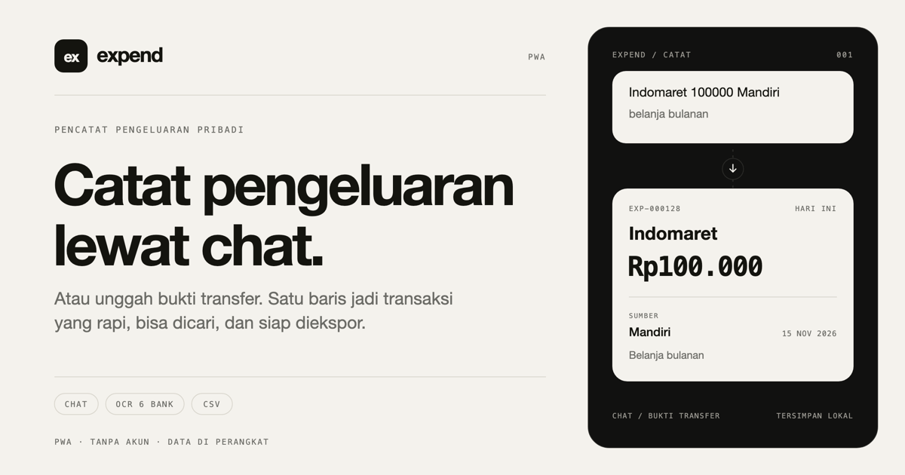

# Expend

**A local-first expense tracker that turns one line of text or a transfer receipt into a structured transaction.**

[](https://sonarcloud.io/summary/new_code?id=eiaiproject_Expend)

Expend is a mobile-first PWA for recording personal expenses. Type a line such as `Indomaret 100000 Mandiri belanja bulanan`, or upload a transfer receipt. Expend extracts the date, payee, amount, funding source, and note, then opens an editable preview before anything is saved. All transactions stay in the browser using IndexedDB; there is no account, backend, or sync service.

The application UI is written in Indonesian. This README documents the behavior in English and quotes Indonesian interface labels where useful.



> **Status:** v0.2.0, early development. The chat parser and core bookkeeping flows are covered by automated tests; receipt layouts and device support are documented under [Known limitations](#known-limitations).

## Contents

- [Overview](#overview)
- [Features](#features)
- [Tech stack](#tech-stack)
- [Code quality](#code-quality)
- [Getting started](#getting-started)
- [Using Expend](#using-expend)
- [Chat input reference](#chat-input-reference)
- [Receipt OCR](#receipt-ocr)
- [Data, privacy, and CSV](#data-privacy-and-csv)
- [PWA and offline behavior](#pwa-and-offline-behavior)
- [Scripts](#scripts)
- [Project structure](#project-structure)
- [Testing](#testing)
- [Deployment](#deployment)
- [Known limitations](#known-limitations)
- [Design credits](#design-credits)

## Overview

Expend is built around two input paths:

1. **A structured chat line.** The user writes the expense in a fixed order. A deterministic parser converts it into a draft.
2. **A transfer receipt.** Tesseract.js reads the image locally, and a layout-aware parser extracts the same fields into the same draft.

Both paths end at one review dialog. Nothing is written to the ledger until the user confirms the preview. Saving creates a transaction number in the form `EXP-000001` and stores the record in IndexedDB.

The project is intentionally static. It can be deployed to any static host, has no API keys or server-side runtime, and works offline after the application shell has been cached. The trade-off is that data is local to one browser profile and cannot sync between devices.

## Features

- **Chat-first capture.** One line becomes a transaction through a rule-based parser. No LLM or remote parsing service is involved.
- **Receipt OCR for six Indonesian banking layouts.** Livin/Mandiri, BCA, BRI, Jago, SeaBank, and GoPay have dedicated parsers, with a label-based generic fallback for other layouts.
- **Review before save.** Every field is editable. Required fields, dates in the future, and length limits are validated in the preview.
- **Local-first storage.** Transactions live in IndexedDB through Dexie. There is no account, backend database, or sync service.
- **Transaction ledger.** Browse all transactions, search, filter by date and funding source, sort the list, and edit or delete records.
- **Month-to-date dashboard.** Shows the current month up to today, a comparison with the equivalent period last month, and daily, weekly, and six-month charts.
- **CSV backup and restore.** Export every transaction with a stable column layout. Import an Expend export to replace the local dataset.
- **Installable PWA.** A Web App Manifest, offline shell, service worker, and a share target for Android.
- **Light, dark, and system themes.** The theme preference persists across sessions and follows the device when set to system.
- **Amount privacy.** One tap replaces every displayed amount with five dots. The preference persists across reloads and tabs.
- **Mobile-first layout.** A bottom tab bar and fixed composer on small screens, and a sidebar on wider screens.

## Tech stack

| Layer | Choice |
| --- | --- |
| UI | React 19 and TypeScript |
| Build | Vite 6 |
| Storage | IndexedDB via Dexie 4 |
| OCR | Tesseract.js 6 with the `ind+eng` language pair |
| Icons | Lucide React |
| Styling | Hand-written CSS with no CSS framework |
| PWA | Web App Manifest and a custom service worker |
| Unit tests | Vitest |
| End-to-end tests | Playwright with Chromium |
| Code quality | SonarQube Cloud automatic analysis |

## Code quality

[SonarQube Cloud](https://sonarcloud.io/project/overview?id=eiaiproject_Expend) analyzes the default branch and pull requests automatically. The analysis scope lives in [`.sonarcloud.properties`](.sonarcloud.properties); no CI token or extra workflow is needed.

## Getting started

### Requirements

- Node.js 20 or newer (Node.js LTS recommended)
- npm
- A current browser with IndexedDB and service worker support. Chromium-based browsers provide the most complete PWA and share-target experience.

No environment variables or API keys are required.

### Run locally

```bash
npm install
npm run dev
```

Open the URL printed by Vite, normally `http://localhost:5173`.

To test the production build, including the service worker:

```bash
npm run build
npm run preview
```

The service worker is registered only in a production build. Testing `npm run dev` alone will not exercise offline behavior.

## Using Expend

| View | What it is for |
| --- | --- |
| **Catat** | The chat-style ledger and composer. Enter an expense line or upload a receipt. |
| **Daftar** | The complete transaction list with search, date and funding-source filters, sorting, editing, and deletion. |
| **Dasbor** | Month-to-date spending, comparison with the same period last month, and daily, weekly, or six-month charts. |
| **Pengaturan** | Theme preference, persistent-storage status, CSV export and import, and the in-app tutorial. |

The standard flow is always:

1. Enter a line or choose a receipt.
2. Review the parsed values in the preview.
3. Save the transaction.

The composer is never cleared just because the preview was cancelled, so an unfinished line is not lost. The eye button in the mobile header or sidebar hides every displayed amount as `•••••`; use it again to reveal them.

### Transaction numbers

Every saved transaction receives a number such as `EXP-000001`. The next number is assigned from the smallest unused value, and deleting a transaction releases its number for reuse. Editing an existing transaction keeps its number.

Transaction numbers are convenient references, not immutable audit IDs. Include the date and payee when reconciling exported data.

## Chat input reference

This is the canonical input format. Following it exactly gives the parser the least ambiguity.

### Canonical format

```text
<date?> <payee> <amount> <source> <note?>
```

- `date` is optional and, when present, must be the **first** token.
- `payee`, `amount`, and `source` are required.
- `note` is optional and goes at the end.
- Write the fields on one line, separated by spaces. Do not use commas or field labels as separators.
- Place the amount immediately before the funding source. This ordering is what makes the parser reliable.
- Review the preview before saving. A line is never saved automatically.

A complete example:

```text
Indomaret 100000 Mandiri belanja bulanan
```

That line produces:

| Field | Value |
| --- | --- |
| Date | Today in WIB |
| Payee | Indomaret |
| Amount | Rp 100.000 |
| Source | Mandiri |
| Note | belanja bulanan |

### Date rules

The date is always interpreted day-first, in the **WIB** time zone (Asia/Jakarta, UTC+7). `12/11` means 12 November, not 11 December.

| Input | Interpretation |
| --- | --- |
| `12/11` | 12 November of the current WIB year |
| `12-11` | 12 November of the current WIB year |
| `12/11/26` | 12 November 2026 |
| `12/11/2026` | 12 November 2026 |
| `12-11-2026` | 12 November 2026 |
| `2026-11-12` | 12 November 2026 |

Rules and edge cases:

- Without a date, Expend uses today's date in WIB. The device's local time zone does not change the ledger date.
- The date must be the first token. A date in the middle of the line becomes part of the payee or note.
- An invalid calendar date such as `31/02` falls back to today and adds a warning to the preview.
- A future date is parsed, but it cannot be saved. The preview reports the validation error.
- Two-digit years are interpreted in the 2000–2099 range.

### Amount rules

Amounts are in Indonesian Rupiah. The parser accepts the common formats below and rounds parsed values to the nearest whole Rupiah.

| Input | Parsed value |
| --- | --- |
| `100000` | Rp 100.000 |
| `100.000` | Rp 100.000 |
| `Rp 50.000` | Rp 50.000 |
| `Rp50000` | Rp 50.000 |
| `50rb` | Rp 50.000 |
| `50 rb` | Rp 50.000 |
| `50k` | Rp 50.000 |
| `1,5jt` | Rp 1.500.000 |
| `2juta` | Rp 2.000.000 |

Notes:

- A standalone number or a number prefixed with `Rp`/`IDR` is accepted.
- Shorthand suffixes may be attached or separated by a space: `rb`, `ribu`, `k`, `jt`, and `juta`.
- Do not use negative values. The amount must be greater than zero.
- The parser uses the number immediately before the funding source. This is deliberate; see [Parsing behavior](#parsing-behavior).

### Funding-source rules

`source` means the account or wallet used to pay, not the merchant or the recipient's bank. The parser normalizes the aliases below to their canonical names. Matching is case-insensitive and ignores surrounding punctuation.

| Canonical source | Accepted aliases |
| --- | --- |
| `Mandiri` | `mandiri`, `livin`, `livin by mandiri` |
| `BCA` | `bca`, `bank bca` |
| `BRI` | `bri`, `brimo` |
| `BNI` | `bni` |
| `Jago` | `jago`, `bank jago` |
| `SeaBank` | `seabank`, `sea bank` |
| `GoPay` | `gopay`, `go pay` |
| `OVO` | `ovo` |
| `DANA` | `dana` |
| `ShopeePay` | `shopeepay`, `shopee pay` |
| `Tunai` | `tunai`, `cash` |

To use a source that is not in this table, leave out the source token and select **Other** in the preview. The chat parser only auto-detects the aliases above; the preview accepts any source name.

### Parsing behavior

The chat parser is deterministic and rule-based. It does not call an AI service. It works as follows:

1. Normalize whitespace and read an optional date from the first token.
2. Collect numeric candidates from the remaining tokens.
3. Prefer the first candidate immediately followed by a recognized funding source. This is why the `10` in `Mitra 10` stays part of the payee: `10` is not followed by a source, while `50000` is.
4. If no candidate is followed by a source, fall back to the first explicit `Rp`/`IDR` amount or the first number greater than or equal to `1000`.
5. Use the text before the selected amount as the payee, remove the generated currency/source tokens, and use the remaining text after the amount and source as the note.
6. Report missing or uncertain fields as warnings in the preview.

Consequences of this design:

- The canonical `payee amount source note` order is strongly recommended. Putting the source before the amount or burying the amount in prose may produce a valid-looking but incorrect preview.
- A payee can contain numbers and spaces, so names such as `Mitra 10`, `Toko 21`, and `7-Eleven` are preserved.
- The parser is not a general natural-language model. If a line is ambiguous, correct it in the preview instead of expecting a hidden guess.
- Repeated whitespace is collapsed. Source matching is case-insensitive; payee and note text keep their original casing.

### Examples

The examples below assume today is in the current WIB year. Dates are shown in ISO form for clarity; the UI uses localized Indonesian dates.

| Input | Date | Payee | Amount | Source | Note |
| --- | --- | --- | --- | --- | --- |
| `Indomaret 100000 Mandiri belanja bulanan` | Today | Indomaret | Rp 100.000 | Mandiri | belanja bulanan |
| `12/11 Kopi Kenangan 25000 BCA 2 gelas` | 12 November, current year | Kopi Kenangan | Rp 25.000 | BCA | 2 gelas |
| `2026-11-03 Parkir 5000 Tunai` | 3 November 2026 | Parkir | Rp 5.000 | Tunai | — |
| `Mitra 10 50000 BCA belanja bahan bangunan` | Today | Mitra 10 | Rp 50.000 | BCA | belanja bahan bangunan |
| `Bakso 50 rb BCA makan siang` | Today | Bakso | Rp 50.000 | BCA | makan siang |
| `Kopi 25000 livin pagi` | Today | Kopi | Rp 25.000 | Mandiri | pagi |
| `Sewa 1,5jt Mandiri kos` | Today | Sewa | Rp 1.500.000 | Mandiri | kos |

### Validation and preview

Every input is shown in a preview dialog with editable fields. The preview cannot be saved until all validation errors are resolved.

| Field | Validation |
| --- | --- |
| Payee | Required; maximum 80 characters |
| Amount | Required; greater than zero; at most Rp 999.999.999.999 |
| Date | Required; a valid calendar date; not after today in WIB |
| Source | Required; may be a custom value entered in the preview |
| Note | Optional; maximum 200 characters |

Parsing warnings do not replace validation. A warning tells the user which field needs attention; the field still has to satisfy the rules above before it can be saved. All fields can be corrected manually without retyping the original line.

## Receipt OCR

The image button in the composer accepts a receipt from the gallery or file picker. OCR runs in the browser with Tesseract.js and the `ind+eng` language pair. The engine, core, and language data are served from the app itself rather than a third-party CDN. The extracted text is passed to the receipt parser and then to the same preview used by chat input.

### Supported layouts

- Livin / Mandiri
- BCA
- BRI
- Jago
- SeaBank
- GoPay

A generic label-based fallback handles other layouts on a best-effort basis. Receipts that use different labels, unusual layouts, or heavy visual effects may produce incomplete fields; for example, BNI has no dedicated layout parser and relies on the fallback. When the bank is not recognized, the preview always shows a warning so the generic result is not mistaken for a dedicated layout.

### OCR behavior

- Images are left untouched when they are already at most 1600 pixels on the longest side and under 3 MB. Larger images are resized to a maximum of 1600 pixels and encoded as JPEG at quality 0.92.
- The first OCR use downloads the Tesseract worker, WebAssembly core, and `ind+eng` language data from the app host. That first use requires a network connection; the service worker caches the assets for later offline use.
- Recognition runs locally in the browser. The receipt image is not uploaded to an application server or a third-party OCR service.
- OCR results are always shown in the preview. Missing fields are flagged; a missing date falls back to today in WIB with a warning.
- The preview image is temporary. It is discarded after saving or closing the preview. A receipt received through the Android share target is staged temporarily in the Cache API and deleted after the app reads it.

## Data, privacy, and CSV

### Where data lives

Transactions are stored in the IndexedDB database `expend` through Dexie. The application has no backend, no account system, and no sync service, so transaction data stays in the browser profile that created it.

Expend asks the browser for persistent storage when the first transaction is saved. The current storage status and a manual request button are available in **Pengaturan**. Persistence reduces the chance of eviction, but it does not protect against clearing site data, using private browsing, or switching browsers. CSV export is the portable backup.

Transaction numbers use a unique IndexedDB index. The ledger queries transactions by date range instead of loading the whole table, and **Daftar** renders 100 rows at a time with a **Muat … transaksi lagi** button.

On first OCR use, Tesseract assets and language data are downloaded from a CDN. Transaction data is not sent as part of that download.

### CSV format

Exports contain every transaction, not only the current filter or date range. The header is:

```csv
nomor transaksi unik,tanggal,penerima,nominal,sumber dana,keterangan tambahan
```

- `tanggal` uses `YYYY-MM-DD`.
- `nominal` is a raw integer without thousands separators.
- Files are UTF-8 with a BOM and use CRLF line endings.
- Text fields are quoted when they contain commas, quotes, or line breaks.
- Text beginning with `=`, `+`, `-`, `@`, tab, or carriage return is prefixed with an apostrophe so a spreadsheet does not evaluate it as a formula. Import removes that protective prefix before saving the value back.

Import only accepts a file with this exact header and valid rows. Nominal values must be whole numbers between 1 and Rp 999.999.999.999, matching the draft validation limit. It is a **full restore**, not a merge: the app validates the whole file, downloads a backup of the current data, and then replaces the local dataset. A malformed file is rejected with row-level errors and does not partially import.

## PWA and offline behavior

- The app is installable and runs in `standalone` display mode.
- The service worker is registered only in production builds. It precaches the application shell, uses network-first navigation with a cached fallback, and serves cached static assets while refreshing them in the background. The cache name includes a per-build version, and an in-app banner offers **Muat ulang** when a new worker is waiting.
- After a successful first production visit, the application shell is available offline. OCR assets are cached by the same service worker after the first OCR run, so later receipt recognition works offline too.
- The manifest declares a share target for images. On Android, an image can be shared from a banking app to Expend; the service worker handles the `POST /share-target` request, stages the file in the Cache API, and redirects to the app. Share-target support varies by browser and is limited on iOS Safari; uploading from the gallery remains the primary path.
- Theme preference supports **Sistem**, **Terang**, and **Gelap**. The preference is stored locally and synchronized across open tabs. The browser chrome color follows the resolved theme, not only the operating-system preference.
- The static shell includes Open Graph and Twitter metadata, JSON-LD `WebApplication` data, `robots.txt`, and a 1200×630 social image. Canonical and social-image URLs are root-relative until a production domain is fixed.

## Scripts

| Command | Purpose |
| --- | --- |
| `npm run dev` | Start the Vite development server. |
| `npm run build` | Run TypeScript checking and build the production app to `dist/`. |
| `npm run preview` | Serve the production build locally. Use this to test the service worker. |
| `npm test` | Run the Vitest unit test suite. |
| `npm run typecheck` | Run `tsc --noEmit` without building. |
| `npm run prepare:ocr` | Copy Tesseract worker/core assets from `node_modules` into `public/`. |
| `npm run test:e2e` | Build and preview the production app on port 4174, then run the Playwright E2E suite. |

If Playwright browsers are not installed yet:

```bash
npx playwright install chromium
```

## Project structure

```text
.
├── public/
│   ├── manifest.webmanifest   PWA metadata and share target
│   ├── sw.js                  Offline shell and share-target handling
│   ├── tessdata/              Committed ind+eng language data
│   ├── tesseract-core/        Generated core assets (gitignored)
│   ├── tesseract-worker.min.js Generated worker script (gitignored)
│   ├── robots.txt             Search-engine crawl policy
│   ├── og-image.png           Social preview image (1200×630)
│   ├── og-image.svg           Editable source for the social image
│   └── icon*.png/svg          Installable app icons
├── src/
│   ├── components/            Screens, composer, dialogs, navigation, settings
│   ├── lib/
│   │   ├── chatParser.ts      Deterministic chat-line parser and validation
│   │   ├── receiptParser.ts   Bank-layout and generic receipt parsers
│   │   ├── draftWarnings.ts   Live filtering of preview warnings
│   │   ├── money.ts           Amount parsing and Indonesian formatting
│   │   ├── sources.ts         Funding-source aliases
│   │   ├── ocr.ts             Tesseract worker and image preparation
│   │   ├── db.ts              Dexie schema and indexed transaction queries
│   │   ├── csv.ts             CSV export, import, and validation
│   │   ├── date.ts            WIB dates and date arithmetic
│   │   ├── theme.ts           Theme preference and application
│   │   └── version.ts         Application version from package.json
│   ├── App.tsx                Application state, views, OCR, and share target
│   ├── main.tsx               React bootstrap and service-worker registration
│   └── styles.css             Application shell and light/dark styling
├── e2e/
│   ├── expend.spec.ts         Playwright CRUD, OCR, and PWA tests
│   └── fixtures/ocr/          Sample receipt for the OCR test
├── scripts/
│   ├── prepare-ocr-assets.mjs Copy Tesseract assets into public/
│   └── stamp-sw.mjs           Stamp the per-build service-worker cache
├── .sonarcloud.properties     SonarQube Cloud automatic-analysis scope
├── index.html                 Static shell, metadata, and theme bootstrap
├── PRD.md                     Product requirements
└── DESIGN.md                  Visual and interaction decisions
```

`public/tesseract-core/` and `public/tesseract-worker.min.js` are generated from installed `node_modules` packages by `npm run prepare:ocr`; they are gitignored and recreated automatically before `dev`, `build`, `preview`, and `test:e2e`. `public/tessdata/` is committed.

`dist/` is generated by `npm run build` and is not edited by hand.

## Testing

The project has two test layers:

- **Unit tests** cover chat parsing, amount formats, CSV parsing and formatting, and receipt parsing. Receipt tests include real OCR text fixtures from representative bank layouts.
- **End-to-end tests** run in Chromium with Playwright using the Pixel 7 profile. They cover creating, reading, updating, and deleting transactions; validation; cancelling a preview without losing composer text; search and filters; navigation and back behavior; chart keyboard access; and custom funding sources.

The Playwright configuration builds the production app, serves it on port 4174, and creates a fresh browser context for each test, so IndexedDB starts empty. The E2E suite covers a real OCR upload, the offline application shell, deterministic date/chart behavior, and the existing CRUD flows. The share target is still verified manually because it requires a browser-level share intent.

Run the checks with:

```bash
npm test
npm run typecheck
npm run test:e2e
```

## Deployment

Expend is designed for a static host. The reference deployment is Cloudflare Pages:

| Setting | Value |
| --- | --- |
| Build command | `npm run build` |
| Output directory | `dist` |
| Environment variables | None |
| Server runtime | None |

The application expects to be served from the domain root because its manifest, service-worker, and asset paths begin with `/`. The only client-side routes are hash URLs such as `/#daftar` and `/#dasbor`; no server-side SPA rewrite is required for those views. The service worker requires HTTPS, except on `localhost`.

The build includes SEO and social metadata in `index.html`. Before launch, replace the root-relative canonical and social-image URLs with absolute URLs for the production domain, and add a `sitemap.xml` once that domain is fixed.

## Known limitations

- **Local to one browser.** Data does not sync across devices or browsers, and clearing site data deletes the ledger. Export CSV regularly.
- **No categories, budgets, or income tracking.** Expend records expenses only.
- **Transaction numbers are reusable.** A deleted number can be assigned again; do not use it as an immutable audit key.
- **The app icon is a placeholder.** Replace `public/icon.svg` and the generated PNG icons before a public release.
- **OCR is best-effort.** Dedicated layouts cover six banks; other layouts use a generic fallback. Image quality, crop, and layout changes can leave fields empty. Always review the preview.
- **First OCR use requires network access.** The Tesseract worker, core, and language data are served from the app host but downloaded on demand; later OCR runs use the service-worker cache.
- **The chat parser is order-sensitive.** It is intentionally rule-based, so an unusual line can produce a misleading draft. The preview exists to catch this.
- **Future dates are rejected.** The ledger is for recorded expenses, not scheduled transactions.
- **Share-target support is uneven.** Chrome on Android provides the complete experience; iOS Safari has platform limitations.

## Design credits

The visual direction was developed with [antislop](https://github.com/miqdadbadjuber/anti-slop) by miqdadbadjuber as a filtering framework and [unslop](https://heydamir.design/unslop) by Damir Sokolovsky, licensed under CC BY 4.0, for direction and interface refinement.

All interface icons come from [Lucide](https://lucide.dev).
